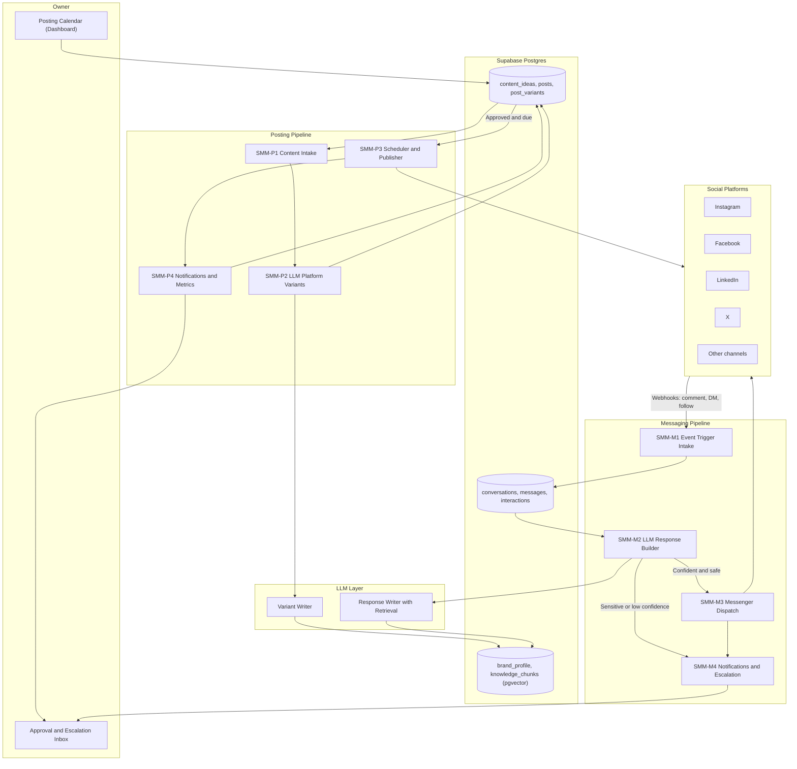
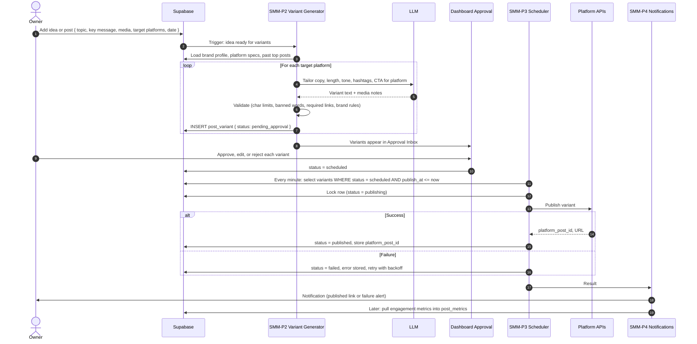
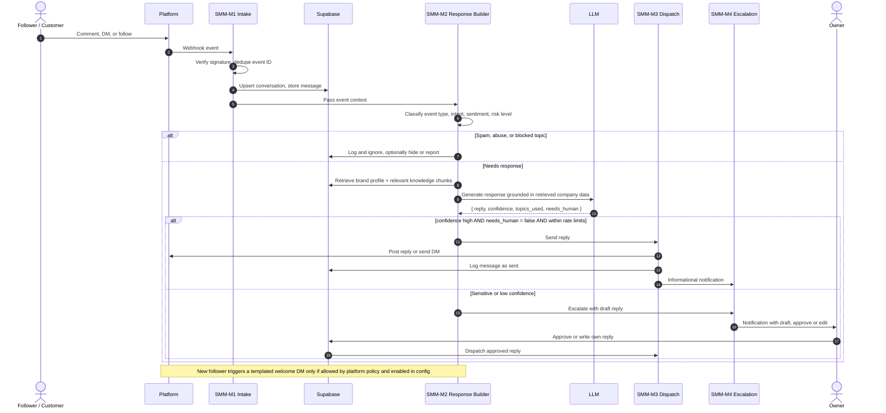
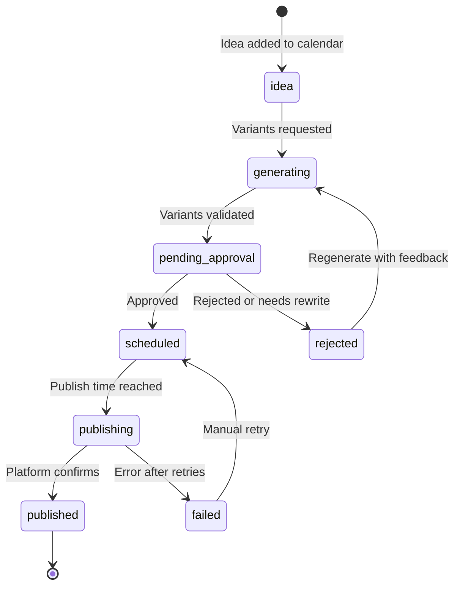
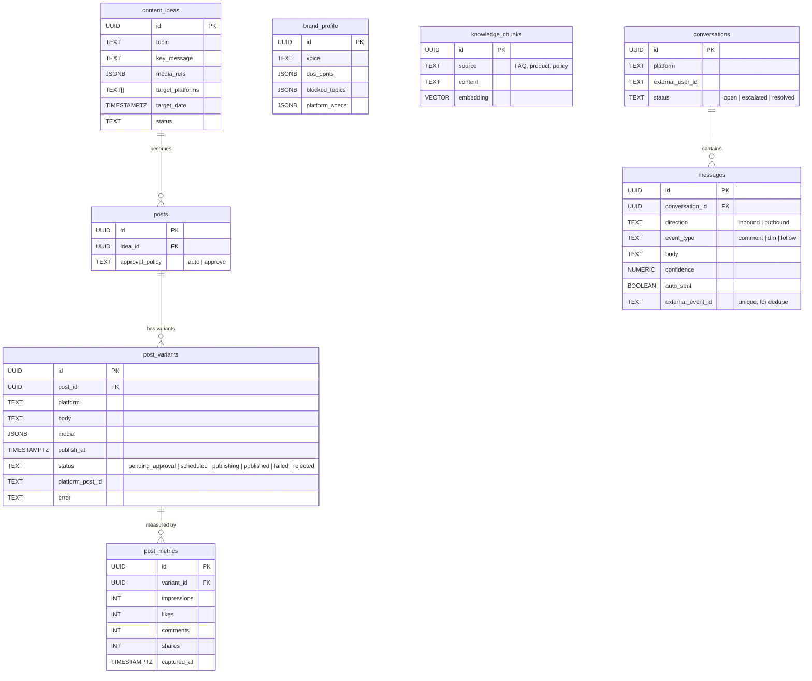

# Automation Architecture — Social Media Management (SMM) System

The **SMM Automation** is a two-pipeline system built on **n8n**, **Supabase (Postgres + pgvector)**, an **LLM API**, and the **social platform APIs**.

- **Posting Pipeline**: ideas and posts live in a content calendar, an LLM tailors each post per platform, schedulers publish, and notifications confirm the result.
- **Messaging Pipeline**: comments, DMs, and follows trigger context-aware responses generated from company data, delivered through the platform messengers, with escalation to a human when needed.


> [!IMPORTANT]
> ### ⚠️ Recommended Production Path: External Schedulers & Messaging Aggregators
> Direct integration with native social platform APIs (Meta Graph API, X API v2, LinkedIn UGC API) is fully documented and provided in these workflows. However, **due to strict and unpredictable app review processes, tight permission gating (e.g. Meta `instagram_manage_messages`, `pages_manage_posts`), aggressive rate limiting, and the persistent risk of platform developer app bans, utilizing certified third-party aggregators (such as Ayrshare, Buffer, Publer, or Metricool for publishing, and ManyChat, Gorgias, or Zendesk for messaging) is the strongly recommended operational path for production deployments.**

---

## 1. Architectural Principles

1. **Brand Consistency**: All generation is grounded in a stored **brand profile** (voice, do/don't list, products, FAQs). The LLM never improvises facts about the company.
2. **Human Authorization Where It Matters**: Posts follow a configurable approval policy (auto, approve-first, or approve-first-N). Replies to sensitive topics (complaints, pricing, legal, refunds) always escalate.
3. **Platform-Native Output**: One idea becomes several variants, each respecting the platform's limits, format, hashtag norms, and media specs.
4. **Safe Automation on Social Platforms**: Rate limits, platform messaging windows, and automation policies are enforced in the workflows. Reply volume is capped to avoid account flags.
5. **Idempotent Publishing**: A post variant is published at most once; the platform post ID is stored immediately and checked before any retry.
6. **Observability**: Every publish and every auto-reply is logged with its input, generated text, confidence, and outcome.

---

## 2. High-Level System Architecture



---

## 3. Core Data Flows & Sequence Diagrams

### 3.1. Posting Pipeline



### 3.2. Messaging Pipeline



### 3.3. Post Variant State Machine



---

## 4. Workflow Catalog (n8n)

| ID | Workflow | Trigger | Key Actions |
| :--- | :--- | :--- | :--- |
| **SMM-P1** | Content Intake | New row in `content_ideas` / calendar | Validate idea, attach brand context, queue for variants |
| **SMM-P2** | LLM Platform Variants | Idea marked ready | Generate and validate one variant per platform, route to approval |
| **SMM-P3** | Scheduler & Publisher | Schedule (every minute) | Select due variants, lock, publish, store platform IDs, retry |
| **SMM-P4** | Notifications & Metrics | Publish result, daily schedule | Notify owner, pull engagement metrics |
| **SMM-M1** | Event Trigger Intake | Platform webhooks (comment, DM, follow) | Verify, dedupe, store conversation |
| **SMM-M2** | LLM Response Builder | New inbound message | Classify, retrieve company data, generate reply, decide auto vs escalate |
| **SMM-M3** | Messenger Dispatch | Approved or auto reply | Respect rate limits, send via platform API, log |
| **SMM-M4** | Notifications & Escalation | Escalation or send result | Notify owner, show draft in inbox |
| **SMM-ERR** | Error Handler | n8n Error Trigger | Alert owner, log failing node |

### 4.1. Platform Variant Rules (editable in `platform_specs`)

| Platform | Typical Adaptation |
| :--- | :--- |
| **LinkedIn** | Longer, professional tone, insight-led opening, few hashtags |
| **Instagram** | Visual-first caption, hook in first line, hashtag block, emoji per brand rules |
| **Facebook** | Conversational, link preview friendly, community tone |
| **X** | Short, punchy, thread split when over the limit |

Exact limits and media specs are stored in config and checked by the validator rather than hardcoded in prompts.

### 4.2. Response Decision Policy

| Condition | Action |
| :--- | :--- |
| Simple FAQ, answer found in knowledge base, confidence high | Auto-reply |
| Compliment or positive comment | Short on-brand reply or reaction |
| Pricing, quote, custom request | Reply with booking link and notify owner |
| Complaint, refund, legal, health, or negative sentiment | Escalate, no auto-reply |
| No relevant knowledge retrieved | Escalate with note "no grounded answer" |
| Spam, abuse | Ignore or moderate, log |
| New follower | Optional welcome DM, only where platform policy permits |

---

## 5. Database Architecture



---

## 6. External Integrations

| Service | Role | Used By |
| :--- | :--- | :--- |
| **Social platform APIs** (Meta Graph API for Instagram and Facebook, LinkedIn, X, others) | Publishing, comments, DMs, follower events | SMM-P3, SMM-M1, SMM-M3 |
| **LLM API** | Variant writing, intent classification, response writing | SMM-P2, SMM-M2 |
| **Supabase + pgvector** | Calendar, conversations, brand data, retrieval | All workflows |
| **Notifications** (Resend email, Slack or Telegram) | Publish results, escalations, failures | SMM-P4, SMM-M4 |
| **Retool Dashboard** | Posting calendar, approval inbox, conversation view | Owner |

> Platform API access, permissions, app review, and automation rules differ per platform and change over time. Verify current requirements for each platform before go-live.

---

## 7. Security & Reliability Architecture

- **Retrieval-grounded replies**: The response LLM receives only retrieved knowledge chunks and the brand profile. If retrieval returns nothing relevant, the workflow escalates instead of answering.
- **Prompt-injection defense**: Incoming comments and DMs are untrusted data, delimited in the prompt, and cannot alter instructions, reveal prompts, or trigger actions.
- **Webhook security**: Platform signature verification on every inbound event; `external_event_id` uniqueness prevents double processing.
- **Rate limiting & caps**: Per-platform reply caps per hour, per-user reply limits, and cooldowns avoid spam-like behavior.
- **Token management**: OAuth tokens stored in the n8n credential vault with expiry monitoring and a refresh-failure alert.
- **Idempotent publishing**: Row lock before publish; `platform_post_id` checked before any retry.
- **Kill switch**: A `smm_enabled` flag per pipeline in config instantly pauses auto-replies or publishing without editing workflows.

| Failure Scenario | Response |
| :--- | :--- |
| Publish API error | Retry with backoff, then mark `failed` and alert |
| Token expired | Alert owner, pause the platform's workflows |
| LLM invalid or empty output | Retry once, then escalate or hold for manual writing |
| Duplicate webhook delivery | Ignored via `external_event_id` |
| Reply flood or suspicious spike | Auto-pause auto-replies, alert owner |

---

## 8. Repository / Workspace File Map

```text
automation-smm/
├── architecture-smm.md
├── workflows/
│   ├── smm-p1-content-intake.json
│   ├── smm-p2-llm-platform-variants.json
│   ├── smm-p3-scheduler-publisher.json
│   ├── smm-p4-notifications-metrics.json
│   ├── smm-m1-event-trigger-intake.json
│   ├── smm-m2-llm-response-builder.json
│   ├── smm-m3-messenger-dispatch.json
│   ├── smm-m4-notifications-escalation.json
│   └── smm-err-error-handler.json
├── prompts/
│   ├── variant-writer.md
│   ├── intent-classifier.md
│   └── response-writer.md
├── knowledge/                          # Source documents embedded into knowledge_chunks
├── sql/schema.sql
└── docs/
    ├── brand-voice.md
    └── escalation-policy.md
```

---

## 9. Environment & Configuration

| Name | Purpose |
| :--- | :--- |
| `LLM_API_KEY` | Variants and responses |
| `META_APP_SECRET`, `META_PAGE_TOKENS`, `LINKEDIN_TOKEN`, `X_API_KEYS` | Platform access (n8n credentials) |
| `SUPABASE_URL`, `SUPABASE_SERVICE_KEY` | Database |
| `AUTO_REPLY_ENABLED`, `AUTO_PUBLISH_ENABLED` | Kill switches |
| `REPLY_CONFIDENCE_THRESHOLD`, `MAX_REPLIES_PER_HOUR` | Tunable safety limits |
| `NOTIFY_CHANNEL`, `OWNER_EMAIL` | Notifications |
