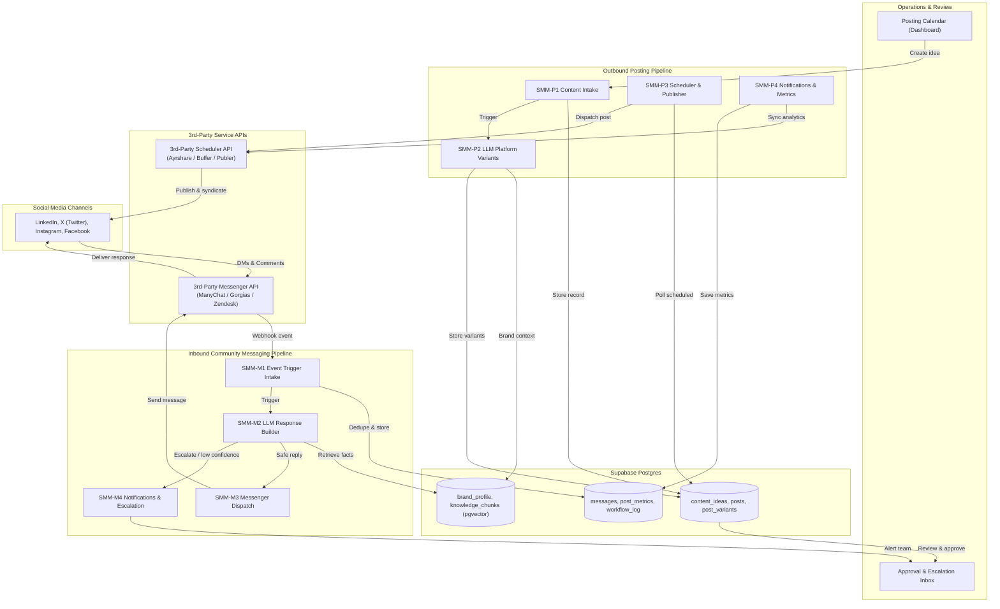
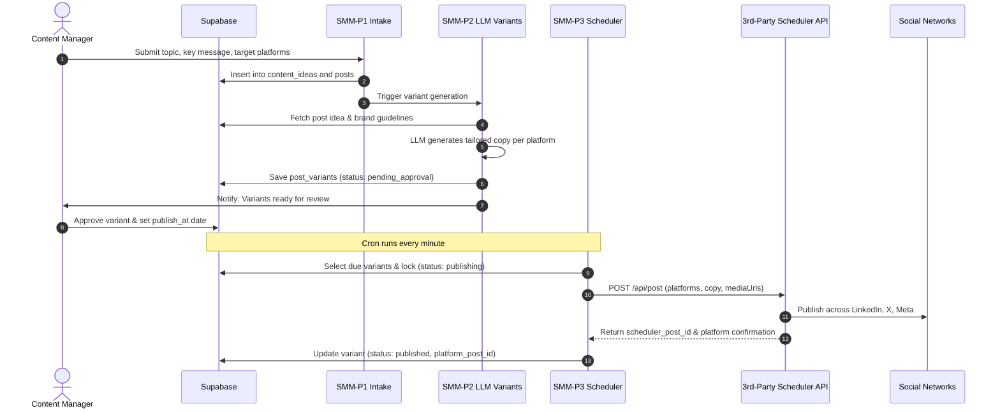
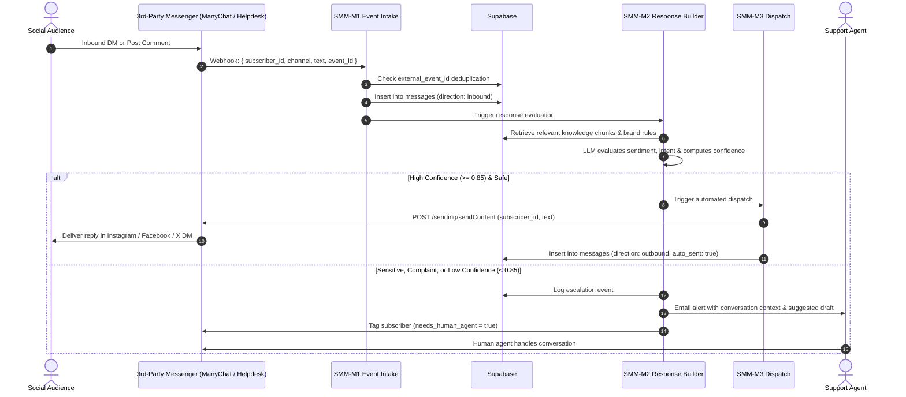

# Automation Architecture — Social Media Management (SMM) System

The **SMM Automation** is a two-pipeline system built on **n8n**, **Supabase (Postgres + pgvector)**, an **LLM API**, **3rd-Party Social Schedulers** (such as Ayrshare, Buffer, or Publer), and **3rd-Party Social Messaging Platforms** (such as ManyChat, Gorgias, or Zendesk).

- **Posting Pipeline**: Content ideas and posts live in a unified calendar. An LLM tailors each post per platform, team members review/approve, scheduled triggers dispatch to the 3rd-party social scheduler API, and delivery metrics are collected automatically.
- **Messaging Pipeline**: Comments, direct messages (DMs), and mentions captured by the 3rd-party messaging platform trigger context-aware AI responses grounded in verified company data, delivered back through the messaging platform with escalation to human staff when needed.

---

## 1. Architectural Principles

1. **Brand Consistency**: All copy generation is grounded in a stored **brand profile** (voice, do/don't guidelines, product catalog, FAQs). The LLM never improvises facts about the company.
2. **Human Authorization Where It Matters**: Posts follow a configurable approval policy (`auto`, `approve-first`, or `approve-first-N`). Replies to sensitive topics (complaints, custom pricing, legal, refunds) always escalate to human staff.
3. **Platform-Native Output**: One content idea produces multiple tailored variants, each matching target network specs (LinkedIn, X, Instagram, Facebook), length constraints, and hashtag norms.
4. **Resilient Production Integrations via Certified 3rd-Party APIs**: Outbound publishing and inbound messaging utilize compliant, partner-tier 3rd-party schedulers (Ayrshare, Buffer, Publer) and messaging platforms (ManyChat, Gorgias). This completely eliminates custom platform app reviews, token expiration churn, sudden API deprecation breaks, and account suspension risks.
5. **Idempotent Publishing & Delivery**: Posts and messages are deduplicated using external event IDs and database row locks, guaranteeing zero double-posts or duplicate customer replies.
6. **End-to-End Observability**: Every generated variant, scheduler dispatch, and auto-reply is recorded in Supabase with full payload audit logs, latency tracking, and confidence scoring.

---

## 2. High-Level System Architecture



---

## 3. Core Data Flows & Sequence Diagrams

### 3.1. Outbound Posting Pipeline


### 3.2. Inbound Community Messaging Pipeline


---

## 4. Workflow Catalog (n8n)

| Workflow ID | Workflow Name | Trigger | Actions | Downstream Call |
| :--- | :--- | :--- | :--- | :--- |
| **SMM-P1** | Content Intake | Webhook (`POST /smm/idea-intake`) | Validates idea, inserts into `content_ideas` & `posts`. | `SMM-P2` |
| **SMM-P2** | LLM Platform Variants | Webhook (`POST /smm/variants`) | LLM tailors copy per platform; saves `post_variants`; notifies owner. | Dashboard Review |
| **SMM-P3** | Scheduler & Publisher | Cron (`* * * * *` Every minute) | Polls due variants, locks row, calls 3rd-Party Scheduler API, records published status. | 3rd-Party Scheduler API |
| **SMM-P4** | Notifications & Metrics | Cron (`0 18 * * *` Daily) | Syncs post impressions & engagements from Scheduler API to `post_metrics`. | Resend / Dashboard |
| **SMM-M1** | Event Trigger Intake | Webhook (`POST /smm/events`) | Ingests 3rd-party messenger webhooks, normalizes payload, dedupes, saves to `messages`. | `SMM-M2` |
| **SMM-M2** | LLM Response Builder | Webhook (`POST /smm/response-builder`) | Semantic RAG lookup, assesses sentiment, calculates confidence score, routes branch. | `SMM-M3` or `SMM-M4` |
| **SMM-M3** | Messenger Dispatch | Webhook (`POST /smm/dispatch`) | Enforces rate caps, dispatches approved reply via 3rd-Party Messenger API, logs message. | 3rd-Party Messenger API |
| **SMM-M4** | Notifications & Escalation | Webhook (`POST /smm/escalate`) | Tags subscriber in messaging tool, emails owner conversation context and AI draft. | Resend Email |
| **SMM-ERR** | Error Handler | Error Trigger | Traps execution errors across pipelines, logs to `workflow_log`, emails admin. | Resend Email |

---

## 5. Database Schema (Supabase)

```sql
-- 1. Content Ideas & Posts
CREATE TABLE IF NOT EXISTS content_ideas (
  id UUID PRIMARY KEY DEFAULT gen_random_uuid(),
  topic TEXT NOT NULL,
  key_message TEXT NOT NULL,
  target_platforms TEXT[] DEFAULT '{linkedin,x}',
  target_date TIMESTAMPTZ,
  media_refs TEXT[] DEFAULT '{}',
  status TEXT DEFAULT 'idea',
  created_at TIMESTAMPTZ DEFAULT now()
);

CREATE TABLE IF NOT EXISTS posts (
  id UUID PRIMARY KEY DEFAULT gen_random_uuid(),
  idea_id UUID REFERENCES content_ideas(id) ON DELETE CASCADE,
  approval_policy TEXT DEFAULT 'approve',
  created_at TIMESTAMPTZ DEFAULT now()
);

-- 2. Platform variants
CREATE TABLE IF NOT EXISTS post_variants (
  id UUID PRIMARY KEY DEFAULT gen_random_uuid(),
  post_id UUID REFERENCES posts(id) ON DELETE CASCADE,
  platform TEXT NOT NULL CHECK (platform IN ('linkedin', 'x', 'instagram', 'facebook')),
  body TEXT NOT NULL,
  publish_at TIMESTAMPTZ,
  status TEXT DEFAULT 'pending_approval' CHECK (status IN ('pending_approval', 'scheduled', 'publishing', 'published', 'failed')),
  platform_post_id TEXT,
  created_at TIMESTAMPTZ DEFAULT now()
);

-- 3. Post metrics snapshot
CREATE TABLE IF NOT EXISTS post_metrics (
  id UUID PRIMARY KEY DEFAULT gen_random_uuid(),
  variant_id TEXT NOT NULL,
  impressions INT DEFAULT 0,
  likes INT DEFAULT 0,
  comments INT DEFAULT 0,
  shares INT DEFAULT 0,
  snapshot_date DATE DEFAULT CURRENT_DATE,
  created_at TIMESTAMPTZ DEFAULT now()
);

-- 4. Inbound & outbound social messages
CREATE TABLE IF NOT EXISTS messages (
  id UUID PRIMARY KEY DEFAULT gen_random_uuid(),
  external_event_id TEXT UNIQUE,
  direction TEXT NOT NULL CHECK (direction IN ('inbound', 'outbound')),
  event_type TEXT DEFAULT 'dm',
  body TEXT NOT NULL,
  auto_sent BOOLEAN DEFAULT false,
  created_at TIMESTAMPTZ DEFAULT now()
);

-- 5. Central workflow error log
CREATE TABLE IF NOT EXISTS workflow_log (
  id UUID PRIMARY KEY DEFAULT gen_random_uuid(),
  workflow_name TEXT NOT NULL,
  node_name TEXT,
  error_message TEXT,
  execution_id TEXT,
  created_at TIMESTAMPTZ DEFAULT now()
);
```

---

## 6. External Integrations

| Service | Role | Used By |
| :--- | :--- | :--- |
| **3rd-Party Social Scheduler API** (Ayrshare, Buffer, Publer, Metricool) | Multi-network post publishing, rate-limit management, media transcoding, analytics | `SMM-P3`, `SMM-P4` |
| **3rd-Party Social Messenger API** (ManyChat, Gorgias, Zendesk, Front) | Capturing inbound DMs/comments, managing 24h compliance window, sending replies | `SMM-M1`, `SMM-M3`, `SMM-M4` |
| **LLM API** (OpenAI `gpt-4o`) | Multi-platform copy variants, intent & sentiment classification, grounded response generation | `SMM-P2`, `SMM-M2` |
| **Supabase (Postgres + pgvector)** | Central state store, content calendar, interaction history, semantic knowledge chunks | All workflows |
| **Transactional Email** (Resend) | Approval ready alerts, human escalation notifications, system failure alerts | `SMM-P2`, `SMM-M4`, `SMM-ERR` |
| **Operations Dashboard** | Review queue for variants, conversation monitoring, knowledge base curation | Owner / Agents |

---

## 7. Security & Reliability Architecture

- **Retrieval-Grounded Responses**: The response engine accesses only indexed company knowledge chunks and official brand parameters. If confidence falls below 0.85 or retrieval returns low relevance, the message is routed to human escalation.
- **Prompt-Injection Defense**: Inbound messages from external users are treated as untrusted text, delimited safely in prompts, and prevented from invoking tools or rewriting instructions.
- **Deduplication Safeguards**: Inbound events are indexed by unique `external_event_id` keys in Supabase, preventing duplicate processing even if webhooks retry.
- **Rate-Limiting & Quotas**: Schedulers and messenger dispatchers enforce throttling to ensure full compliance with platform rules.
