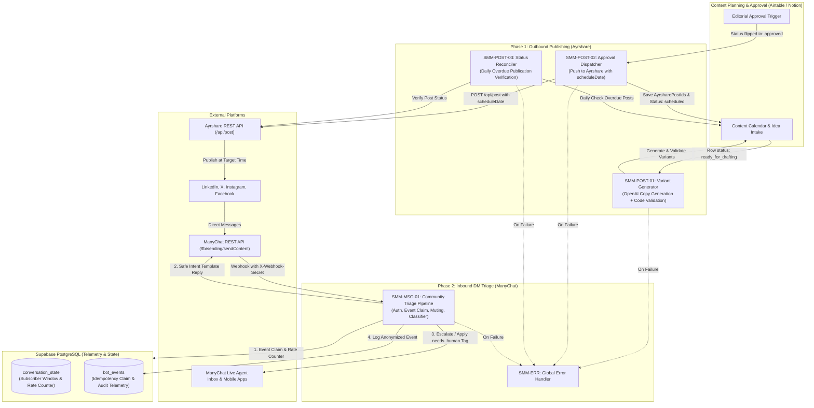
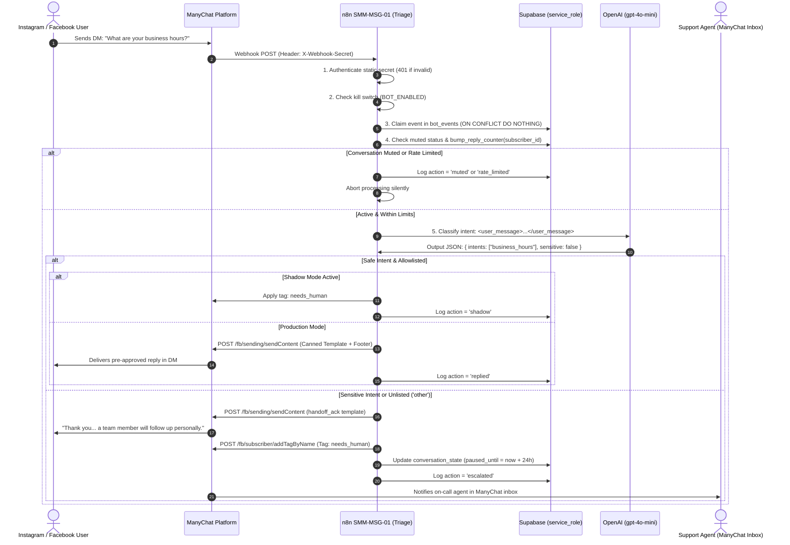
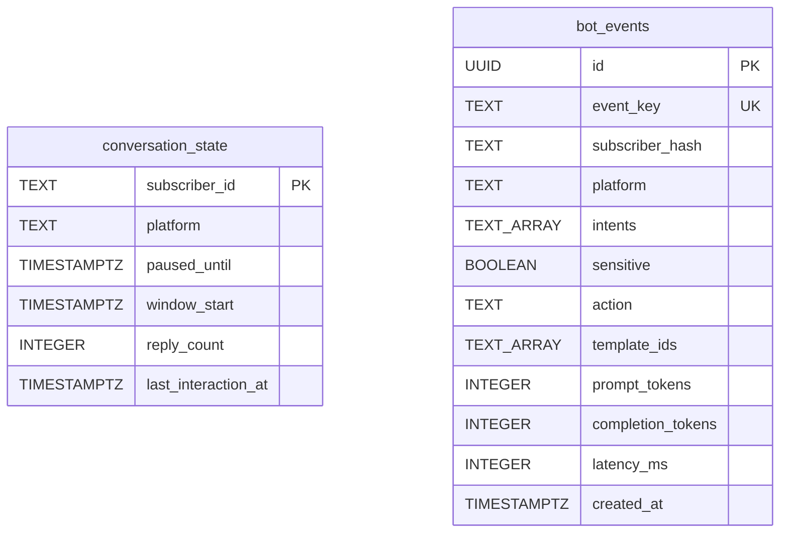

# Automation Architecture — Social Media Management (SMM) System

**Status:** Draft Architecture Specification  

---

## Executive Summary

The **Social Media Management (SMM) System** provides multi-network social publishing and customer direct message triage by integrating 3rd-party platforms (**Ayrshare** for outbound scheduling and **ManyChat** for inbound messaging) coordinated through **n8n** and **Supabase**.

### 1. Scope and Limitations

* **Supported Publishing Networks (v1)**: LinkedIn, X (formerly Twitter), and Instagram.
* **Supported Messaging Channels (v1)**: Instagram Direct Messages and Facebook Messenger **DMs only**.
* **Excluded Messaging Channels**: All messaging networks other than Instagram and Facebook Messenger direct messages are strictly out of scope.
* **Excluded Interactions**: Public-comment replies, X direct messages, LinkedIn direct messages, and platform mentions are out of scope. (Note: Comment-to-DM triggers configured natively inside ManyChat execute prior to this webhook pipeline and are managed outside this repository).
* **Single Content Store**: All post drafting, variant editing, and human approvals occur inside the Content Calendar (Airtable by default; Notion acceptable). The database does not mirror post copy or scheduling queues.

### 2. Background & Decision Record

* **Background**: Prior iterations polled relational databases on 1-minute intervals, maintained duplicate posting calendars, and permitted the automated bot to generate freeform text that talked over active human support agents.
* **Architecture Decision**: Outbound scheduling is pushed directly to Ayrshare at approval time with `scheduleDate`, while inbound messaging enforces a classification-only LLM step, strict intent allowlisting, and deterministic canned templates with bot muting.
* **Changelog**:
  * Removed internal database posting queues in favor of a single Content Calendar store.
  * Replaced freeform LLM DM replies with a closed intent classification schema and pre-approved canned templates.
  * Added atomic per-subscriber rate limiting and human-takeover muting.
  * Added automated status reconciliation workflow (`SMM-POST-03`).
  * Removed vector search complexity in favor of in-prompt policy guidelines.

---

## 1. Architectural Principles

1. **Leverage the Scheduler, Avoid Redundant Queues**: Posts are pushed to Ayrshare at approval time with a `scheduleDate` timestamp. Ayrshare manages network rate limits, media encoding, token management, and delivery timing.
2. **Deterministic Canned Templates Over Freeform Generation**: Inbound community triage uses the language model strictly as a classifier. The model outputs structured intent tags and sensitivity flags; it never authors reply copy. User messages are answered strictly using verified canned templates.
3. **Muting on Human Handoff**: If a conversation is paused or claimed by a human operator in ManyChat (`live_chat_status: "open"`), the bot mutes immediately to avoid interrupting human interactions.
4. **Code-Level Platform Validation**: Character lengths (X weighted rules, LinkedIn 3,000 characters) and media rules (Instagram strictly requires image or video media) are validated deterministically in code before approval.
5. **Defense-in-Depth & Loop Protection**: Inbound webhooks enforce static secret verification (`X-Webhook-Secret`). User messages are capped at 5 automated replies per subscriber per hour to prevent infinite bot loops.
6. **Transparent Bot Disclosure & Compliance**: Every automated DM reply includes a standard automated disclosure footer in compliance with Meta Platform policies, including explicit instructions for requesting human escalation.

---

## 2. High-Level System Architecture



---

## 3. Core Data Flows & Sequence Diagrams

### 3.1. Outbound Content Creation & Scheduled Publishing

```mermaid
sequenceDiagram
    autonumber
    actor Creator as Content Creator
    participant Cal as Content Calendar (Airtable)
    participant N8N_P1 as n8n SMM-POST-01 (Generator)
    participant LLM as OpenAI (gpt-4o)
    actor Approver as Marketing Lead
    participant N8N_P2 as n8n SMM-POST-02 (Dispatcher)
    participant Ayrshare as Ayrshare API
    participant Networks as Social Networks (LinkedIn, X, Instagram)

    Creator->>Cal: Creates record with Title, KeyMessage, MediaURLs (Status: ready_for_drafting)
    Cal->>N8N_P1: Webhook trigger (ready_for_drafting)
    N8N_P1->>LLM: Generate platform variants using brand voice
    LLM->>N8N_P1: Return JSON { linkedin, x, instagram }
    N8N_P1->>N8N_P1: Code Validation: X <= 280 weighted chars, IG has media, hashtags <= 30
    alt Validation Passed
        N8N_P1->>Cal: Update record (Status: ready_for_approval, Variants populated)
    else Validation Failed
        N8N_P1->>Cal: Update record (Status: needs_edit, ValidationNotes populated)
    end
    Approver->>Cal: Reviews variants, sets Status = approved with PublishAt
    Cal->>N8N_P2: Webhook trigger (approved)
    N8N_P2->>Cal: Re-read record; claim Status = scheduling
    N8N_P2->>Ayrshare: POST /api/post (platforms, scheduleDate, per-platform text)
    alt Schedule Success
        Ayrshare->>N8N_P2: Return post ID (id: "ayr_12345")
        N8N_P2->>Cal: Update record (Status: scheduled, AyrsharePostIds: "ayr_12345")
        Ayrshare->>Networks: Delivers post at scheduled timestamp
    else Schedule Error
        Ayrshare->>N8N_P2: API error response
        N8N_P2->>Cal: Update record (Status: failed, Error: error_message)
    end
```

### 3.2. Inbound Community Triage Pipeline



---

## 4. Content Calendar & State Specifications

### 4.1. Content Calendar Fields (Single Content Store)

The Content Calendar in Airtable (or Notion) maintains all post copy, assets, and scheduling states:

| Field Name | Type | Description |
| :--- | :--- | :--- |
| `Title` | Single line text | Working internal title of the content item. |
| `KeyMessage` | Long text | Core talking points, summary, or source brief for copy generation. |
| `MediaURLs` | Multiple attachment / URL | Image or video assets required for visual platforms (mandatory for Instagram). |
| `TargetPlatforms` | Multiple select | Platforms selected for publication (`linkedin`, `x`, `instagram`). |
| `PublishAt` | Date & Time (UTC) | Planned publication date and time. Must be at least 10 minutes in the future when approving. |
| `Status` | Single select | Post lifecycle status (see transition state table below). |
| `VariantLinkedIn` | Long text | Platform-tailored copy generated for LinkedIn. |
| `VariantX` | Long text | Platform-tailored copy generated for X (under 280 weighted characters). |
| `VariantInstagram` | Long text | Platform-tailored copy generated for Instagram (with hashtags). |
| `ValidationNotes` | Long text | Validation errors or feedback recorded if code validation fails. |
| `AyrsharePostIds` | Single line text | Remote post identifiers returned by Ayrshare API upon successful scheduling. |
| `Error` | Long text | Diagnostic error message recorded if vendor scheduling fails. |

### 4.2. Post Lifecycle Status Transitions

```
[idea] ──► [ready_for_drafting] ──► (SMM-POST-01) ──► [ready_for_approval]
                                             │               │
                                             │ (fails checks)│ (human approves)
                                             ▼               ▼
                                       [needs_edit]      [approved]
                                                             │
                                                             ▼ (SMM-POST-02 claims)
                                                        [scheduling]
                                                             │
                                             ┌───────────────┴───────────────┐
                                             ▼ (Ayrshare success)            ▼ (Ayrshare error)
                                        [scheduled]                       [failed]
                                             │
                                             ▼ (SMM-POST-03 reconciles)
                                        [published]
```

| From Status | Transition Trigger | To Status | Performed By |
| :--- | :--- | :--- | :--- |
| `idea` | Creator adds key message and requests variants | `ready_for_drafting` | Content Creator |
| `ready_for_drafting` | Code validation passes on generated copy | `ready_for_approval` | `SMM-POST-01` |
| `ready_for_drafting` | Validation fails after retry attempt | `needs_edit` | `SMM-POST-01` |
| `needs_edit` | Creator updates brief or manually tweaks copy | `ready_for_drafting` | Content Creator |
| `ready_for_approval` | Editorial lead reviews and approves post | `approved` | Marketing Lead |
| `approved` | Dispatcher claims record before vendor API call | `scheduling` | `SMM-POST-02` |
| `scheduling` | Ayrshare accepts post payload | `scheduled` | `SMM-POST-02` |
| `scheduling` | Ayrshare rejects post or lead time insufficient | `failed` | `SMM-POST-02` |
| `scheduled` | Post confirmed published after scheduled time | `published` | `SMM-POST-03` |
| `scheduled` | Post rejected or failed delivery at scheduled time | `failed` | `SMM-POST-03` |

### 4.3. ManyChat Tagging & Operator Visibility

| Tag Name | Application Trigger | Operational Meaning |
| :--- | :--- | :--- |
| `needs_human` | Sensitive inquiry detected, unlisted intent, rate limit hit, shadow mode run, or kill switch engaged. | Signals that the conversation requires human attention in the ManyChat inbox. |

---

## 5. Workflow Catalog (n8n)

| ID | Workflow | Trigger | Primary Purpose | Writes To |
| :--- | :--- | :--- | :--- | :--- |
| **SMM-POST-01** | Variant Generator | Webhook / Airtable trigger (`ready_for_drafting`) | Generates copy variants for LinkedIn, X, and Instagram via `gpt-4o`. Validates length and media rules in code. | Content Calendar (`ready_for_approval` or `needs_edit`) |
| **SMM-POST-02** | Approval Dispatcher | Webhook / Airtable trigger (`approved`) | Enforces lead time, claims `scheduling` status, and pushes post to Ayrshare API with `scheduleDate`. | Content Calendar (`scheduled` or `failed`) |
| **SMM-POST-03** | Status Reconciler | Daily Schedule (`0 4 * * *`) | Queries Ayrshare history for overdue scheduled posts and updates status to `published` or `failed`. | Content Calendar (`published` or `failed`) |
| **SMM-MSG-01** | Community Triage Pipeline | ManyChat Webhook (`POST /smm/manychat-webhook`) | Verifies static secret, checks mute/rate limit, classifies intent, and sends canned templates or triggers handoff. | ManyChat API, `conversation_state`, `bot_events` |
| **SMM-ERR** | Global Error Handler | Error Trigger | Catches unhandled workflow errors and emails administrators via Resend. | Admin notification email |

---

## 6. Database Architecture & Privacy (Supabase)

The database holds no post copy and no inbound message text. It functions strictly as an operational state and anonymized telemetry store:



### Data-Flow & Privacy Table

| Data Store / Service | Data Stored | PII Present | Retention Period | Access Controls |
| :--- | :--- | :--- | :--- | :--- |
| **Content Calendar (Airtable)** | Post ideas, key messages, copy variants, media links, scheduling IDs | None (marketing copy only) | Indefinite (content library) | Airtable role permissions; scoped API token |
| **Supabase `conversation_state`** | Subscriber platform ID, rate counter, pause expiration timestamp | Pseudonymous platform ID | **30 days idle** (purged via `purge_expired_data()`) | `service_role` only; RLS enabled |
| **Supabase `bot_events`** | Event key, salted subscriber hash, classified intents, action, token metrics | None (One-way hashed subscriber ID; **no message content**) | **30 days** (purged via `purge_expired_data()`) | `service_role` only; RLS enabled |
| **Ayrshare API** | Social copy variants, media URLs, target accounts, post IDs | None | Per Ayrshare account retention | Bearer API Key |
| **ManyChat Platform** | Subscriber name, profile data, full message history, assigned tags | Yes (Full customer DM history in native inbox) | Per ManyChat account data policies | ManyChat Workspace RBAC & API Token |
| **OpenAI API** | Inbound message text for classification (transient) | Transient in request | Transient (Zero Data Retention agreement recommended) | TLS encryption; Bearer API Key |

---

## 7. Open Decisions / To Verify

The following items are deferred for validation against operational tooling:

1. **Content Calendar Selection (Airtable vs. Notion)**:
   * **Recommendation**: Airtable is recommended due to native webhook automations on status change and granular field-level permission tokens.
   * **Trigger Mechanism**: Verify whether the calendar triggers n8n via instant webhook automation or periodic polling.
2. **ManyChat Platform Capabilities**:
   * **Live Chat Status Exposure**: Verify whether the ManyChat webhook payload or REST API reliably exposes the current live-chat conversation state (`live_chat_status === 'open'`).
   * **API Endpoint Paths**: Verify whether custom fields and tags use `/fb/subscriber/addTagByName` and `/fb/subscriber/setCustomField` across all connected platforms.
   * **Event Identifier**: Verify whether ManyChat webhook events provide a persistent unique message ID in the payload to use directly as `event_key`.
   * **Agent Notification Workflow**: Setting the `needs_human` tag requires a ManyChat internal automation rule to notify human agents (e.g. mobile push notification). This must be configured manually inside ManyChat.
   * **Early Unmuting**: Verify how operators can manually clear `paused_until` early if an agent resolves an inquiry ahead of schedule.
3. **Ayrshare API Capabilities**:
   * **Per-Platform Copy in Single Call**: Verify whether Ayrshare's `/api/post` endpoint accepts individual platform copy overrides (`twitter`, `instagram`, `linkedin`) in a single unified API request.
   * **Idempotency Keys**: Verify whether Ayrshare supports an idempotency key header or unique reference ID to prevent duplicate scheduling on network retries.
   * **Publication Status Webhook**: Verify whether Ayrshare provides an outbound webhook upon post publication to replace the daily reconciler (`SMM-POST-03`).
   * **Account Tier Limitations**: Confirm whether the target Ayrshare subscription tier permits direct API posting to X.
4. **Environment & Runtime Infrastructure**:
   * **X Character Weighting**: Verify whether custom n8n runner environments support importing the `twitter-text` library for exact CJK and URL weighting.
   * **`pg_cron` Availability**: Verify whether the Supabase instance includes `pg_cron` for scheduling `purge_expired_data()`.
   * **Independent Secondary Alerting**: Determine whether critical failures should dispatch to a secondary alerting channel (e.g. Slack webhook) if Resend encounters downtime.

---

## 8. Repository Layout & File Map

```text
smm-automation/
├── architecture.md                     # Draft System Architecture Specification (this document)
├── README.md                           # Deployment Guide, Setup Walkthrough, and Test Plan
├── .env.example                        # Template for all environment variables and secrets
├── prompts/
│   ├── brand-voice.md                  # Tone, hashtag constraints, and per-platform formatting rules
│   └── reply-templates.md              # Closed intent templates, handoff acknowledgment, and footer
├── n8n-workflows/
│   ├── smm-post-01-variant-generator.json     # Generates platform variants from calendar ideas
│   ├── smm-post-02-approval-dispatcher.json   # Validates lead time and schedules post via Ayrshare
│   ├── smm-post-03-status-reconciler.json     # Daily reconciler verifying publication of overdue posts
│   ├── smm-msg-01-triage-pipeline.json        # Authenticated DM triage, rate limiting, and intent routing
│   ├── smm-err-error-handler.json             # Global error handler and administrator notifier
│   └── CHANGES-REQUIRED.md                    # Node-level design for regeneration loops & event claiming
└── sql/
    └── schema.sql                             # Hardened schema with deny-by-default RLS and rate function
```
