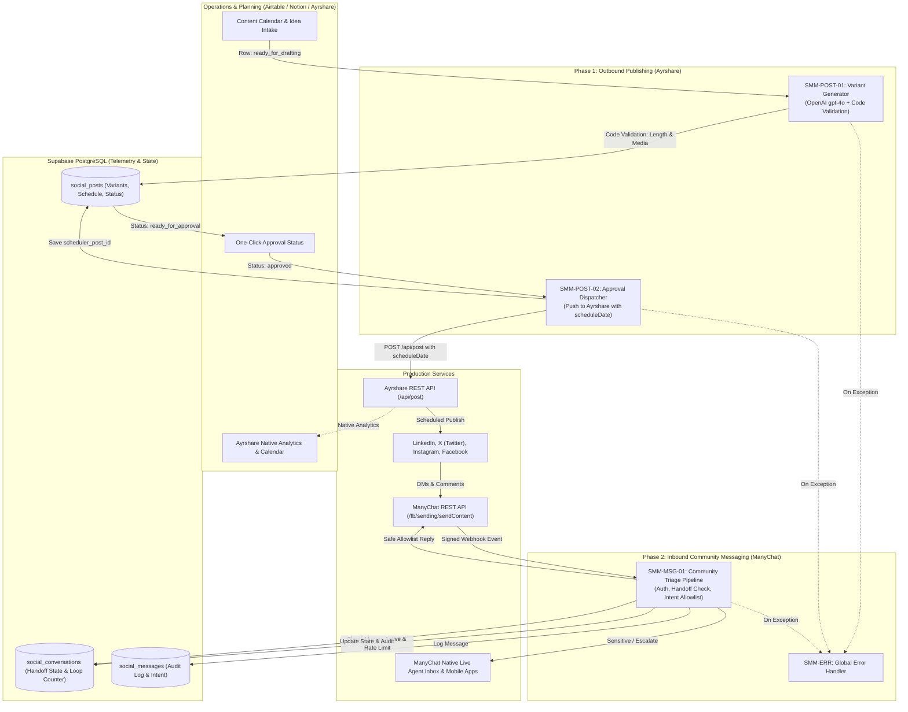
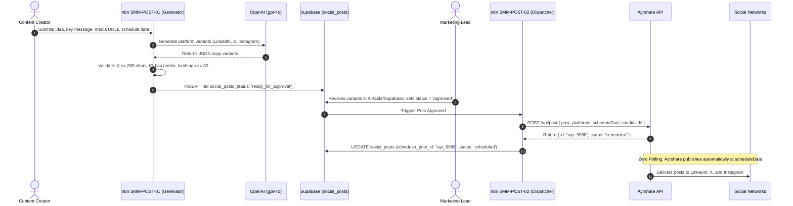
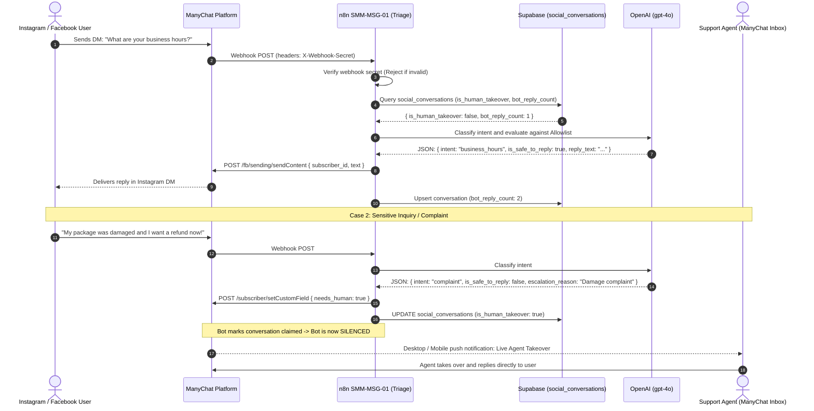

# Automation Architecture — Social Media Management (SMM) System

**Document Version:** 2.0
**Author:** Robin Sehnalík

---

## Executive Summary

The **Social Media Management (SMM) System** provides reliable, multi-network social posting and safe customer community triage by leveraging established 3rd-party platforms (**Ayrshare** for outbound scheduling and **ManyChat** for inbound messaging) coordinated through **n8n** and **Supabase**.

### 1. Architectural Refactoring & Problem Statement

Previous iterations suffered from significant over-engineering and critical logic gaps:

1. **Rebuilding the Scheduler on Top of a Scheduler**: The old design polled PostgreSQL every minute, applied row locks, and called publisher APIs at execution time (`SMM-P3`). Modern social schedulers (Ayrshare) natively accept a `scheduleDate` parameter. By pushing approved posts with a target schedule date at approval time, all database polling, row locks, worker queue congestion, and double-posting bugs are completely eliminated.
2. **Duplicate Dashboard & Analytics Debt**: Building custom posting calendars, approval inboxes, and analytics sync workers (`SMM-P4`) reinvented features that Ayrshare, Airtable, and Notion already provide out of the box.
3. **Unsafe Messaging Gaps**: The previous community responder lacked webhook signature authentication, relied on uncalibrated self-reported LLM confidence scores, suffered from infinite bot-to-bot loop risks, and critically lacked a **handoff state** (meaning the bot would talk over a human agent who had taken over the conversation).
4. **Premature `pgvector` Complexity**: Managing chunking pipelines and vector databases for static social FAQs added latency and infrastructure costs when standard brand policies comfortably fit inside modern LLM context windows.

### 2. The Refactored Solution

The modernized system decouples social management into two dedicated, low-complexity phases:

- **Phase 1: Outbound Social Publishing (2 Workflows)**:
  - **Tool Selected**: **Ayrshare API** (`https://app.ayrshare.com/api/post`).
  - Ingests topics from Airtable/Notion, generates platform-specific variants (LinkedIn, X, Instagram) via OpenAI `gpt-4o`, enforces strict code-level character and media validation, and on human approval, dispatches directly to Ayrshare with `scheduleDate`.
- **Phase 2: Safe Community Messaging (1 Consolidated Workflow)**:
  - **Tool Selected**: **ManyChat API** (`https://api.manychat.com`).
  - Ingests verified webhooks (`X-Webhook-Secret`), checks human handoff state in ManyChat (muting the bot if an agent is active), enforces loop protection (max 5 replies/hour), uses in-context cached prompt policies, and gates auto-replies behind a **strict intent allowlist**. Sensitive topics (complaints, refunds, legal) immediately trigger live agent takeover in ManyChat.

---

## 1. Architectural Principles

1. **Leverage the Scheduler, Don't Rebuild It**: Posts are pushed to Ayrshare at approval time with `scheduleDate`. Ayrshare handles platform retries, media transcode/CDN upload, token refreshes, and delivery timing.
2. **Strict Intent Allowlisting Over Uncalibrated Scores**: An LLM's self-reported confidence score (e.g. 0.85) is uncalibrated. Auto-replying is restricted strictly to an allowlist of deterministic intents (`business_hours`, `shipping_policy`, `catalog_link`, `returns_policy`, `general_faq`). Any complaint, refund demand, or price negotiation escalates to human staff.
3. **Guaranteed Human Handoff Muting**: If a conversation is claimed by a human operator in ManyChat (`live_chat_status: "open"`) or marked paused in the database, the bot immediately aborts execution.
4. **Code-Level Platform Validation**: Character constraints (280 for X, 3000 for LinkedIn) and platform requirements (**Instagram strictly requires image/video media**) are validated in code before approval.
5. **In-Context Prompt Grounding**: Brand FAQs, policies, and tone are held directly in the prompt context, eliminating premature pgvector complexity.
6. **Defense-in-Depth & Loop Protection**: All inbound webhooks verify secret tokens. Inbound user messages are capped at 5 automated replies per session to prevent bot-to-bot infinite loops and API quota drain.

---

## 2. High-Level System Architecture



---

## 3. Core Data Flows & Sequence Diagrams

### 3.1. Phase 1: Content Ingestion, Validation, and Scheduled Publishing



### 3.2. Phase 2: Inbound Community Message Triage & Handoff Muting



---

## 4. Workflow Specifications

### 4.1. Phase 1 Workflows (Outbound Publishing)

| File                                                                                           | Name                            | Trigger                    | Action & Validation                                                                                                                                      |
| :--------------------------------------------------------------------------------------------- | :------------------------------ | :------------------------- | :------------------------------------------------------------------------------------------------------------------------------------------------------- |
| [`smm-post-01-variant-generator.json`](./n8n-workflows/smm-post-01-variant-generator.json)     | SMM-POST-01 Variant Generator   | Webhook / Airtable trigger | Generates LinkedIn, X, and IG variants via `gpt-4o`. **Code Validation**: X <= 280 chars, IG requires media and <= 30 hashtags, LinkedIn <= 3000 chars.  |
| [`smm-post-02-approval-dispatcher.json`](./n8n-workflows/smm-post-02-approval-dispatcher.json) | SMM-POST-02 Approval Dispatcher | Approval status change     | Formats multi-platform overrides and dispatches directly to Ayrshare API (`POST /api/post`) with `scheduleDate`. Eliminates all polling and row-locking. |

### 4.2. Phase 2 Workflows (Community Messaging & Support)

| File                                                                                 | Name                                 | Trigger          | Action & Validation                                                                                                                                                                                                      |
| :----------------------------------------------------------------------------------- | :----------------------------------- | :--------------- | :----------------------------------------------------------------------------------------------------------------------------------------------------------------------------------------------------------------------- |
| [`smm-msg-01-triage-pipeline.json`](./n8n-workflows/smm-msg-01-triage-pipeline.json) | SMM-MSG-01 Community Triage Pipeline | ManyChat Webhook | Verifies `X-Webhook-Secret`. Checks if human agent active or max replies reached (5/hr). Triage via cached prompt FAQ against strict **Intent Allowlist**. Sends safe reply or triggers live agent takeover in ManyChat. |
| [`smm-err-error-handler.json`](./n8n-workflows/smm-err-error-handler.json)           | SMM-ERR Global Error Handler         | Error Trigger    | Catches uncaught runtime exceptions across pipelines and alerts team via Resend email.                                                                                                                                   |

---

## 5. Database Architecture & Schema (Supabase)

The database is streamlined from 5 redundant tables down to **3 clean tables**:

```sql
-- 1. Social Posts Table (Unified Ideas & Platform Variants)
CREATE TABLE IF NOT EXISTS social_posts (
  id UUID PRIMARY KEY DEFAULT gen_random_uuid(),
  title TEXT NOT NULL,
  key_message TEXT NOT NULL,
  media_urls JSONB DEFAULT '[]'::jsonb,
  target_platforms JSONB NOT NULL DEFAULT '["linkedin", "twitter", "instagram"]'::jsonb,
  variants JSONB DEFAULT '{}'::jsonb, -- { "linkedin": "...", "twitter": "...", "instagram": "..." }
  status TEXT DEFAULT 'draft' CHECK (status IN ('draft', 'ready_for_approval', 'approved', 'scheduled', 'published', 'failed')),
  scheduled_for TIMESTAMPTZ,
  scheduler_post_id TEXT, -- ID returned by Ayrshare API
  error_message TEXT,
  created_at TIMESTAMPTZ DEFAULT now(),
  updated_at TIMESTAMPTZ DEFAULT now()
);

-- 2. Social Conversations & Handoff State (ManyChat / Instagram / WhatsApp)
CREATE TABLE IF NOT EXISTS social_conversations (
  id UUID PRIMARY KEY DEFAULT gen_random_uuid(),
  subscriber_id TEXT UNIQUE NOT NULL, -- ManyChat subscriber ID
  platform TEXT NOT NULL CHECK (platform IN ('instagram', 'facebook', 'whatsapp', 'telegram')),
  is_human_takeover BOOLEAN DEFAULT false,
  paused_until TIMESTAMPTZ,
  bot_reply_count INTEGER DEFAULT 0,
  last_interaction_at TIMESTAMPTZ DEFAULT now(),
  created_at TIMESTAMPTZ DEFAULT now()
);

-- 3. Social Messages (Telemetry & Audit)
CREATE TABLE IF NOT EXISTS social_messages (
  id UUID PRIMARY KEY DEFAULT gen_random_uuid(),
  conversation_id UUID REFERENCES social_conversations(id) ON DELETE CASCADE,
  external_message_id TEXT UNIQUE NOT NULL,
  sender_type TEXT NOT NULL CHECK (sender_type IN ('subscriber', 'bot', 'agent')),
  intent TEXT,
  content TEXT NOT NULL,
  status TEXT DEFAULT 'delivered' CHECK (status IN ('delivered', 'escalated', 'quarantined', 'failed')),
  token_usage JSONB DEFAULT '{}'::jsonb,
  latency_ms INTEGER DEFAULT 0,
  created_at TIMESTAMPTZ DEFAULT now()
);

-- Performance & Query Indexes
CREATE INDEX IF NOT EXISTS idx_social_posts_status ON social_posts(status);
CREATE INDEX IF NOT EXISTS idx_social_posts_scheduled_for ON social_posts(scheduled_for);
CREATE INDEX IF NOT EXISTS idx_social_conv_subscriber ON social_conversations(subscriber_id);
CREATE INDEX IF NOT EXISTS idx_social_msg_conv ON social_messages(conversation_id);
```

---

## 6. Security & Safety Guardrails

1. **Webhook Signature & Secret Verification**:
   The `/smm/manychat-webhook` endpoint strictly authenticates the `X-Webhook-Secret` header before any payload processing. Unauthenticated calls are rejected with 401 Unauthorized.
2. **Deterministic Intent Allowlist**:
   Auto-replies are restricted to safe, factual inquiries (`business_hours`, `shipping_policy`, `catalog_link`, `returns_policy`, `general_faq`). Sensitive topics (complaints, damage reports, pricing negotiation, legal threats) automatically escalate to human operators.
3. **Guaranteed Bot Muting on Human Handoff**:
   The workflow checks both ManyChat's live chat status and Supabase's `is_human_takeover` flag. Once an agent claims a conversation, the bot is immediately silenced to prevent talking over human team members.
4. **Loop Protection & Spend Cap**:
   Automated replies are strictly throttled to a maximum of 5 replies per user session to eliminate bot-to-bot recursion and prevent LLM API cost drain.
5. **Code-Level Pre-Flight Validation**:
   Character limits (X <= 280) and media rules (Instagram requires image/video) are validated in JavaScript code rather than trusting the LLM to follow instructions.

---

## 7. Comparative Metrics: Legacy vs. Streamlined

| Dimension                  | Legacy Over-Engineered Architecture        | Streamlined Architecture                            |
| :------------------------- | :----------------------------------------- | :-------------------------------------------------- |
| **Workflow Count**         | 9 chained workflows + webhook hops         | **3 decoupled workflows** + 1 error handler         |
| **Scheduler Architecture** | Custom 1-minute polling + DB row locks     | **Direct Ayrshare API push with `scheduleDate`**    |
| **Double-Post Risk**       | High (race conditions on polling worker)   | **Eliminated** (Idempotent vendor scheduling)       |
| **Dashboards & Inboxes**   | Custom calendar, inbox, and metrics tables | **Native Ayrshare Calendar + ManyChat Inbox**       |
| **Handoff Protection**     | None (Bot talked over live human agents)   | **Strict bot-muting state check**                   |
| **Safety Gating**          | Uncalibrated LLM confidence score (0.85)   | **Deterministic Intent Allowlist**                  |
| **Database Footprint**     | 5 tables + pgvector + missing foreign keys | **3 normalized tables with foreign keys & indexes** |
